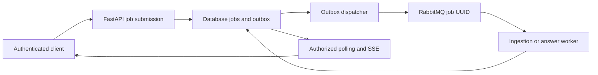

# IncidentOps

An evidence-grounded incident investigation learning project for senior engineers preparing for Staff/Principal AI interviews.

The fictional NimbusCloud image publisher starts failing after deployment 2.7. IncidentOps retrieves applicable runbooks and historical evidence for two fictional tenants, validates quoted support and persists results for authorized inspection. All supplied data is synthetic; there are no real infrastructure mutations.

The main path is **v2 durable asynchronous RAG**. It stores ingestion and answer jobs before background execution, stages document updates, combines dense retrieval with BM25 and releases validated citations. The original v1 synchronous LangGraph baseline remains available for comparison.

## Run the free demo

Prerequisites: Python **3.12–3.14** and [uv](https://docs.astral.sh/uv/getting-started/installation/). Run from the repository root:

```bash
uv sync --frozen
uv run incidentops-workflow demo
uv run pytest -q
```

The demo always uses fake providers, temporary SQLite and local objects with tracing disabled. It runs actual migrations, ingests current operator-visible fixtures, answers PUB-403 and demonstrates that executing the completed job again does no work. No model key or broker is needed. Installation downloads dependencies; fake execution makes no model calls. A fake test passing is evidence of mechanics, not answer quality.

For persistent state and API requests, follow the [step-by-step v2 setup](docs/guides/production-s2-s3.md#2-persistent-local-path-without-a-broker). It covers `migrate`, `seed-local`, `serve`, submitting a job, running its worker and polling. A public submission returns **202 + Location**; a worker must execute it before an answer is available.

## Current flow



## Diagram Summary

The database records accepted work and results; RabbitMQ wakes workers. Ingestion checkpoints batches and atomically promotes a document generation. Answer workers retrieve authorized evidence, call a model asynchronously and validate quotes. The free demo executes the same persisted jobs locally without a broker. See the [full architecture and sequence diagrams](docs/architecture.md).

## Stack and implemented boundary

| Area | Implemented choice |
|---|---|
| API and contracts | FastAPI, Pydantic, trusted demo-token identity, request bounds, async submission/polling/cancellation |
| Source processing | LangChain `Document`, `RecursiveCharacterTextSplitter`, redaction, stable hashes/offsets, versioned source metadata |
| Durable state | SQLAlchemy async + Alembic; PostgreSQL deployment, SQLite local tests |
| Background execution | Celery/RabbitMQ, transactional outbox, separate small/large/answer queues, leases/fencing, finite retries and recovery |
| Retrieval | Async vector-index protocol, pgvector HNSW/exact controls, Pinecone adapter, BM25+dense RRF, candidate/final top-k, exact-text deduplication |
| Incremental ingestion | Staged generations, per-document revision CAS, persisted embedding batches and tenant/model/content-scoped embedding reuse |
| Objects | Content-addressed local storage or versioned S3 adapter with checksums |
| Models and diagnostics | Native async embedding/chat calls, deterministic fake mode, optional OpenAI, safe LangSmith summaries, persisted SSE progress |
| Evaluation | Answerable/unanswerable fixtures, deterministic failure tests, configurable retrieval experiments, opt-in service tests |

The retrieval-only API has a separate deployment entry point. Workers currently call its shared module in-process; remote authenticated routing is a later step. Semantic reranking has an injection port but is **disabled** in the supplied runtime. BM25 is a capped in-memory reference adapter.

## Run the broker/PostgreSQL lab

With Docker/Compose installed:

```bash
INCIDENTOPS_PROVIDER=fake INCIDENTOPS_VECTOR_BACKEND=pgvector \
  docker compose --profile workflows up --build -d workflow-api dispatcher ingest-small ingest-large investigations

docker compose --profile workflows exec workflow-api incidentops-workflow enqueue-fixtures
```

The workflow API is on localhost **8002**, the optional retrieval-only API on **8003**, and RabbitMQ management on **15672**. This is a single-instance lab. Follow the [full deployment/settings guide](docs/guides/production-s2-s3.md#3-real-broker-and-postgresql-path-using-compose) for dependencies, ports, optional Pinecone/S3 and service tests. Do not overwrite an existing `.env` when copying `.env.example`.

## Read and learn

| Document | Purpose |
|---|---|
| [Architecture](docs/architecture.md) | Current components, ingestion/answer sequences, trust and deployment boundaries |
| [Low-level design](docs/low-level-design.md) | Actual tables, job states, interfaces, transactions, retrieval and failure rules |
| [Production design](docs/production-design.md) | Technology decisions, alternatives and remaining scale/HA controls |
| [V2 setup and failure lab](docs/guides/production-s2-s3.md) | Exact run commands and recovery exercises |
| [Retrieval interview lab](docs/guides/retrieval-lab.md) | HNSW, RRF, top-k, duplicates, updates, grounding limits and model interview answers |
| [ADR 0003](docs/adr/0003-durable-jobs-and-generations.md) | Why jobs, outbox, generations and replay have their current boundaries |
| [Verification](docs/verification-v2.md) | Executed checks, measured fake results, skipped services and known limits |
| [Troubleshooting](docs/guides/troubleshooting.md) | Setup, queued jobs, conflicts, sources and configuration |
| [Active plan](docs/plans/production-evolution/2026-11-05-execplan.md) | Delivered stages and next acceptance gates |
| [Learning roadmap](docs/roadmap.md) | Remaining RAG, graph, memory, action and evaluation exercises |
| [Research](docs/research/production-sources.md) | Official sources behind the decisions |

`src/incidentops/durable/` contains the v2 API, repository, runtime, CLI and broker. `retrieval/` contains index contracts/adapters and hybrid fusion; `object_storage.py`, `chunking.py`, `models.py`, `providers.py`, `security.py` and `tracing.py` supply shared components. `migrations/`, `tests/` and `data/` contain schema revisions, checks and synthetic fixtures. `uv.lock` pins resolved dependencies.

For the retained baseline, use the [v1 guide](docs/guides/legacy-v1.md), [v1 learning exercises](docs/guides/learning-lab.md) and [S1 migration](docs/guides/production-s1.md). `incidentops` runs v1; `incidentops-workflow` runs v2. Their source stores are separate.

## Verification and next stages

Run `uv run ruff check .`, `uv run ruff format --check .` and `uv run pytest -q`. The [verification record](docs/verification-v2.md) distinguishes passing local tests from unrun PostgreSQL/RabbitMQ/cloud integrations. Tiny fake datasets and local timings do not establish semantic quality, distributed throughput or HA.

Next stages include Redis global quotas/fair scheduling, queue admission, semantic reranking/judges, actual token/cost accounting, production identity/RLS, persistent LangGraph investigations and approved simulator actions. [Production design](docs/production-design.md) describes the target; it must be read alongside the implemented boundary above.
