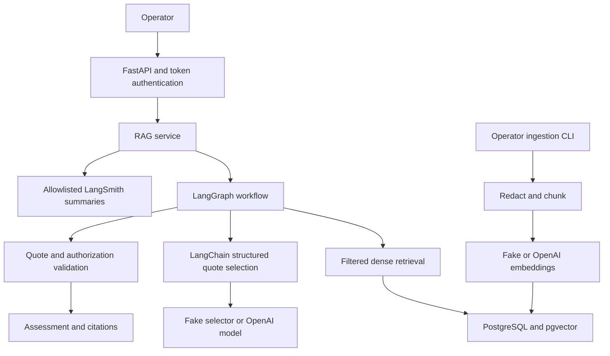
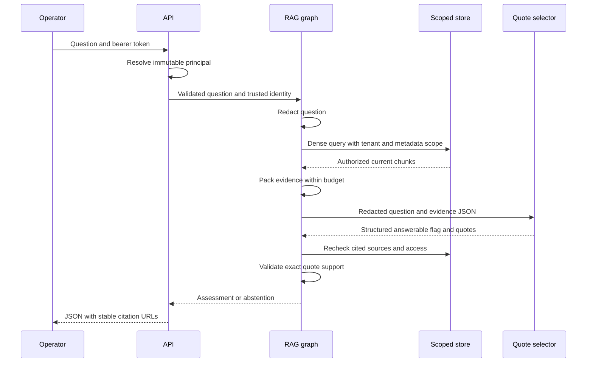

# High-level architecture

## Product boundary

The operator asks a documentation question about NimbusCloud publication failures. Acme's PUB-403 runbook describes a missing publish permission; Bravo's describes the wrong namespace. Returning Bravo's plausible explanation to Acme would be both a correctness and an isolation failure.

Increment 1 searches static knowledge. It can answer “What prerequisite does the runbook give for rollback?” It cannot answer “Has this migration completed?” or “What caused today's incident?”. There are no live tools or recovery actions yet.

## Components

Plain-English summary: authenticated identity limits the database query, the provider selects quotes, code checks those quotes, and a separate telemetry boundary exports only allowlisted measurements. Offline execution replaces PostgreSQL with SQLite exact search and OpenAI with explicitly fake providers.

| Component | Responsibility | Why separate it? |
|---|---|---|
| `api.py` | Authenticate and validate HTTP requests | Tenant identity cannot come from model output or JSON fields |
| `ingestion.py` | Load, redact and chunk versioned sources | Transformations are reproducible and independently testable |
| `store.py` | Persist evidence; apply scope before ranking | Authorization stays visible in SQL |
| `providers.py` | Embed text and select structured quotes | Change providers without changing access policy |
| `pipeline.py` | Orchestrate retrieval, generation and validation | Explicit state and termination are understandable before agents |
| `tracing.py` | Export safe measurements | Tracing cannot casually serialize the whole state |
| `evaluation.py` | Compare results with references | Wrong abstentions and infrastructure failures remain visible |

## Request sequence

Plain-English summary: retrieval and response validation both enforce policy. If the context cannot fit evidence or the provider fails, the graph terminates with a specific abstention reason.

## Why these technologies?

**LangChain** supplies provider interfaces, prompt composition and typed model output. Application policy stays in ordinary Python. This reduces provider coupling without hiding the security rules in a framework default.

**LangGraph** makes the stages and conditional no-evidence branch explicit. A simple function could implement this increment with less overhead. The graph is used because later increments need branching and durable pauses; this version remains an acyclic workflow with no agent loop, reducer, memory or checkpointer to imply durability it does not have.

**PostgreSQL/pgvector** keeps source metadata and vectors in one transaction boundary. Exact cosine search is sufficient for this tiny corpus and provides a useful future reference for ANN experiments. There is no HNSW index or scaling claim. SQL prefilters are easier to inspect here than a generic vector-store abstraction; the LangChain embedding interface remains reusable.

**SQLite and fake providers** let you debug the controls without infrastructure or paid calls. They do not prove PostgreSQL equivalence, semantic retrieval quality or LLM reasoning. A real PostgreSQL CI job and an opt-in live path are distinct verification layers.

**LangSmith** receives measurements through an explicit export boundary. Full automatic traces would expose more intermediate state and make debugging easier; this version deliberately reduces exported content. No remote tracing happens by default.

## Data ownership and consistency

Source IDs include tenant, document identity, version, chunk ordinal and redacted text hash before SHA-256 hashing. The database stores redacted chunks and hashes. Reusing a source version with different redacted text fails; full-corpus replacement commits atomically after all embeddings succeed.

Access changes are reflected by reingestion. Removed, revoked or superseded sources return 404 from citation lookup. Old citation IDs remain deterministic, but this increment does not promise permanent access to archived versions. Long-lived audit citations require an immutable archive with independent authorization, planned later.

The application rechecks retrieved metadata and claims before returning them. These checks reduce exposure from concurrent ingestion; they do not create a globally atomic authorization snapshot across a database, model provider and HTTP response. Production revocation semantics need a documented policy revision or transactional snapshot strategy.

## Quality boundaries

- An exact quote can be irrelevant, misleading out of context or wrong in its source. Textual validation is not semantic entailment or a hallucination-detection score.
- Answerability is a provider judgment. Deterministic code forces abstention on missing context and invalid grounding, but it cannot know that every plausible quote answers the question.
- Synthetic fixtures expose specific failure modes; the fake selector knows a few scripted intents. Its evaluation scores are plumbing results.
- There are eight source files and ten evaluation cases. These are starting exercises, not a representative distribution.
- No real operational evidence enters the system. A source describing a permission failure is not proof that the current incident has that cause.

## Scaling discussion for interviews

The present workload is one developer and a tiny corpus. No concurrency, throughput, availability, quality or cost SLO has been measured. Establish a real workload before choosing targets.

| Pressure | Current choice | What changes at scale and why |
|---|---|---|
| More documents | Exact filtered vector search | Benchmark ANN against exact neighbors and evidence recall; selective ACL filters affect ANN behavior |
| Many requests | Sync endpoints in FastAPI threadpool, per-call DB connections | Add connection pools, bounded concurrency, admission control and cancellation |
| Expensive embeddings | Full corpus embedding before replacement | Add content-addressed, tenant-scoped embedding reuse and incremental indexes |
| Provider outages | Finite timeout and one retry, explicit abstention | Add circuit breakers and evaluated provider fallbacks; never fake a successful response |
| Access revocation | Reingest and recheck before release | Version authorization policy; invalidate caches and memory against that revision |
| Long investigations | None in increment 1 | Durable worker, typed evidence reducers, checkpoints and bounded diagnostic budgets |
| Unsafe recovery | No action path | Exact-plan approvals, downstream idempotency and reconciliation in a simulator |
| Privacy | Synthetic data, limited regex redaction, minimal traces | Classifiers/DLP, retention, encryption, access review and adversarial evaluation |

A production system would separate migration privileges from the runtime DB role and use schema migrations, OIDC, row-level security, managed secrets, backup/restore tests and workload-specific monitoring. Those are explicit future requirements, not consequences of using Docker.

## Official API references checked

- [LangChain ChatOpenAI integration](https://docs.langchain.com/oss/python/integrations/chat/openai): structured model output adapter.
- [LangGraph graph API](https://docs.langchain.com/oss/python/langgraph/graph-api): typed state, conditional edges and compilation.
- [LangSmith sensitive-data controls](https://docs.langchain.com/langsmith/mask-inputs-outputs): hide/mask trace payloads.
- [pgvector](https://github.com/pgvector/pgvector): exact search, cosine operator and image tags.
- [OpenAI structured outputs](https://developers.openai.com/api/docs/guides/structured-outputs) and [embeddings](https://developers.openai.com/api/docs/guides/embeddings): live adapter contracts.

Checked 2026-11-03; the resolved SDK versions are in `uv.lock`. Account model availability and remote service behavior must still be tested locally.
