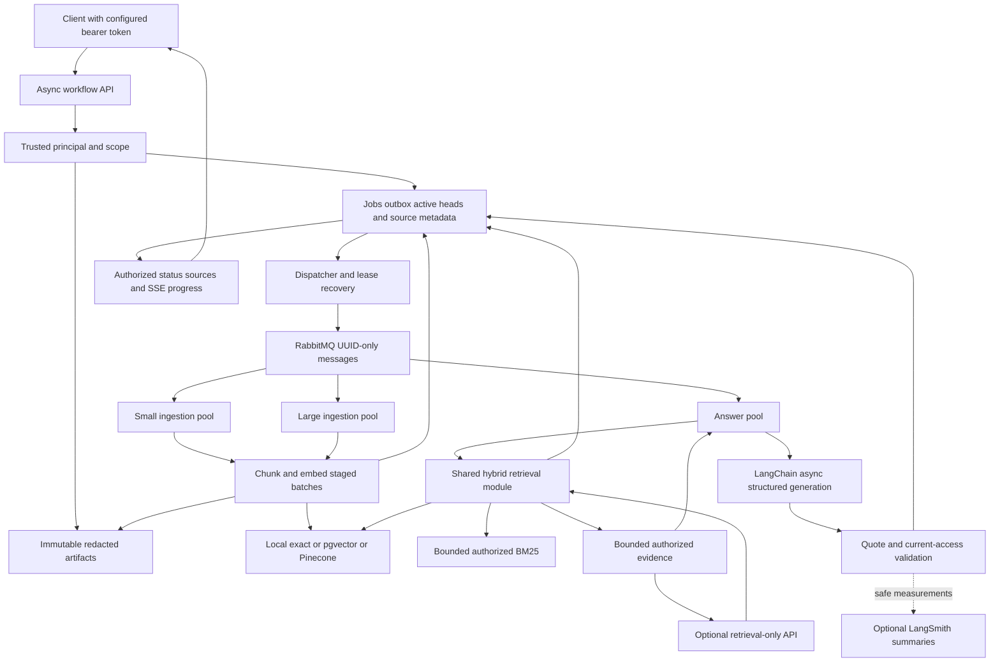

# Current architecture: v2 durable RAG

This describes implemented v2 code as of 2026-11-05. The [production design](production-design.md) describes additional target controls, and [verification](verification-v2.md) states what actually ran. V1 is retained in the [legacy guide](guides/legacy-v1.md).

## Product and trust boundaries

An operator investigates NimbusCloud publication failures using static, versioned sources. Acme's PUB-403 runbook describes missing publish permission; Bravo's describes a wrong namespace. Similar text never grants access to another tenant's evidence.

The system can answer what a runbook says. It cannot observe today's migration state or execute a recovery action. Live diagnostic tools, a separate simulator and persistent agent investigations remain later stages. V2 currently uses an explicit async workflow runner; the small LangGraph in `pipeline.py` belongs to v1.

## Component flow



## Diagram Summary

The relational store owns accepted work, document visibility and authorization metadata. Object storage preserves the redacted source representation. A broker notification contains a job ID, while a worker must claim a database lease before writing. Ingestion and answering have different pools. Retrieval merges dense and lexical candidates, and code validates evidence before results are released.

The standalone retrieval-only API is an optional entry point to the same module. Workers do **not** call it over the network today. Model requests occur for answer generation; the retrieval-only endpoint returns evidence without generating an answer. The component diagram groups these capabilities; the sequences below show their distinct execution paths.

## Deployment and ownership

| Process / module | Responsibility | Entry point / lab port |
|---|---|---|
| Workflow API | Authentication, request bounds, artifact/job acceptance, status/cancel/source/SSE | `incidentops-workflow serve`; host default 8000, Compose 8002 |
| Dispatcher | Eligible outbox publication, expiry/retry and lost-delivery reconciliation | `incidentops-workflow dispatch` |
| Ingestion workers | Library splitting, checkpointed embeddings, idempotent vector upsert, generation promotion | Celery queues `ingestion.small` and `ingestion.large` |
| Answer workers | Scoped retrieval, bounded async model request, validated persisted assessment | Celery queue `investigations` |
| Retrieval-only API | Bounded `/v2/retrieve` and authorized source lookup | `incidentops-workflow serve-retrieval`; host 8001, Compose 8003 |
| PostgreSQL | Job/source/access authority and batch checkpoints | Compose `db`, localhost 5432 |
| Vector adapter | Candidate search only; source hydration stays relational | Local exact, pgvector or Pinecone |
| Object adapter | Immutable source bytes and exact version/hash reference | Local volume or opt-in S3 |

Compose starts schema/index initialization before workflow processes. It provides single PostgreSQL/RabbitMQ instances and a shared local object volume. Async code, restart policies and durable queues do not establish multi-zone availability. See [setup](guides/production-s2-s3.md) for commands and [production design](production-design.md) for HA requirements.

## Ingestion sequence

```mermaid
sequenceDiagram
    participant C as Client
    participant A as Workflow API
    participant O as Object store
    participant D as Relational DB
    participant P as Dispatcher
    participant B as RabbitMQ
    participant W as Ingestion worker
    participant E as Embeddings
    participant V as Vector index
    C->>A: POST ingestion job and idempotency key
    A->>A: Authenticate, validate and redact
    A->>O: Store immutable redacted artifact
    O-->>A: Exact version, size and SHA-256
    A->>D: Capture head revision; commit job and outbox
    D-->>A: Existing or newly accepted job
    A-->>C: 202 and polling Location
    P->>D: Recover leases; read eligible outbox
    P->>B: Publish job UUID to selected queue
    B-->>P: Publisher confirmation
    P->>D: Mark outbox published
    B->>W: Deliver UUID, possibly more than once
    W->>D: Atomic claim, attempt and fencing token
    W->>O: Read pinned artifact and verify checksum
    W->>W: Split with pinned LangChain profile
    W->>D: Begin invisible staging generation
    loop Bounded batches under heartbeat and deadline
        W->>D: Load checkpoint and scoped embedding cache
        opt Missing embeddings
            W->>E: Native async embedding request
            E-->>W: Vectors
            W->>D: Commit batch, checksum and derived cache
        end
        W->>V: Idempotent generation/chunk upsert
    end
    W->>D: Verify fence and completeness; CAS active head and succeed
    C->>A: Poll job or replay progress events
    A->>D: Authorized job/result lookup
    A-->>C: Current status and safe result
```

An object upload and DB acceptance are separate transactions. A crash can leave an orphan artifact. A broker confirmation means acceptance by the broker, not job completion. Batch persistence precedes vector upsert so an interrupted upsert can repeat without repeating an already recorded embedding request. A provider response lost before its checkpoint can still be billed twice.

Only the final relational transaction switches one document's head and marks ingestion successful. A revision conflict preserves the existing active generation. Other documents and tenants are not replaced. Pinecone acknowledgement does not guarantee immediate dense query visibility; that readiness barrier remains future work.

## Answer and retrieval sequence

```mermaid
sequenceDiagram
    participant C as Client
    participant A as Workflow API
    participant D as Relational DB
    participant B as Dispatcher and broker
    participant W as Answer worker
    participant E as Query embeddings
    participant V as Dense vector index
    participant L as BM25 branch
    participant M as Structured model
    C->>A: POST answer job and idempotency key
    A->>D: Commit redacted question, job and outbox
    A-->>C: 202 and Location
    B->>W: Deliver persisted job UUID
    W->>D: Claim lease; load current authorized generations
    alt No eligible evidence
        W->>D: Persist insufficient-evidence assessment
    else Eligible evidence exists
        W->>E: Embed redacted query
        par Scoped dense candidates
            W->>V: Search permitted tenant and generations
            V-->>W: Candidate IDs and scores
        and Authorized lexical candidates
            W->>L: BM25 over capped authorized text
            L-->>W: Ranked IDs
        end
        W->>W: RRF, exact dedup, candidate/final k and context budget
        W->>M: Propose evidence IDs and exact quotes
        M-->>W: Untrusted structured draft
        W->>D: Recheck source identity, permissions and quotes
        W->>D: Fenced result/event commit
    end
    C->>A: GET job or events with cursor
    A->>D: Revalidate stored citations and duplicate provenance
    A-->>C: Assessment or withheld stale evidence
```

The standalone `/v2/retrieve` endpoint performs the search portion under a request timeout and returns evidence; it does not enqueue an answer or call the chat model. Reranking is an optional validated port, disabled in the supplied runtime. SSE streams durable **progress events**, not model token fragments. The [retrieval lab](guides/retrieval-lab.md) explains ranking and quality experiments.

## Isolation and failure rules

- Trusted tenant/principal/groups come from the server's token adapter, never model output or arbitrary tenant headers. Group snapshots are a demo limitation; global identity revocation needs a production identity service.
- Query scope includes current nondeleted generation, document ACL, source date/status, service/region/release and embedding profile. Dense results hydrate only from that authorized set.
- Worker writes require the current fence, live lease and unexpired deadline. Repeated deliveries cannot create a second active owner. Cancellation and recovery revoke old ownership.
- Stored answers are checked again when polled. Revoked/replaced sources invalidate release; duplicate provenance is separately filtered.
- Redaction precedes object persistence, embeddings, model input and diagnostics. Automatic raw tracing is disabled; only allowlisted summaries are exported.
- Separate pools, bounded request/context/batch sizes, finite retries and deadlines are implemented. Global provider quotas, bounded backlog, fair scheduling, circuit breakers and cost reservations remain planned.

See [low-level design](low-level-design.md) for exact tables and state transitions, [ADR 0003](adr/0003-durable-jobs-and-generations.md) for alternatives, and [verification](verification-v2.md) for actual evidence.
