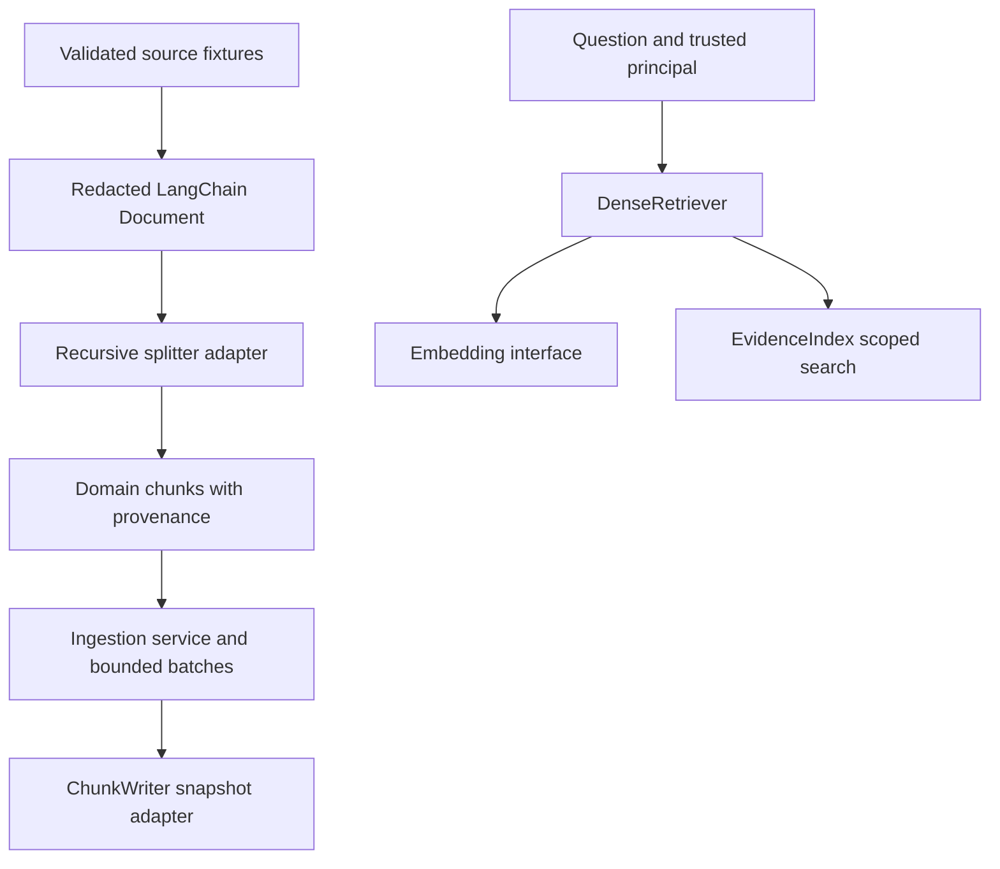

# S1: Library-based ingestion and service boundaries

## What changed

This is the first implementation step of the deeper production request. It replaces manual splitting with LangChain Document/RecursiveCharacterTextSplitter, separates ingestion/retrieval modules, introduces narrow ports and bounds embedding calls. It does not yet implement the distributed target in [production-design.md](../production-design.md).



## Plain-English Summary

LangChain handles document splitting; application adapters preserve policy and provenance. Ingestion and retrieval can be tested independently, but are still in-process modules at this step. The later [v2 guide](production-s2-s3.md) documents the durable worker path.

## Abstractions before code

A **port** is a small contract describing an operation the application needs. A **protocol** expresses that contract in Python without requiring every adapter to inherit a shared implementation. An **adapter** uses a particular library or database to satisfy it. A **composition root** wires dependencies together; here it is `factory.py`.

Read `ports.py`, `chunking.py`, `services/ingestion.py`, `services/retrieval.py`, then `factory.py`. Notice that ingestion does not import Store or ChatOpenAI, and the graph delegates retrieval to a Retriever rather than embedding/searching directly. The existing RAG facade retains compatibility attributes used by tests/evaluation; the whole repository is not claimed to have completed a SOLID redesign.

## New settings and migration

```dotenv
INCIDENTOPS_CHUNK_SIZE_CHARS=350
INCIDENTOPS_CHUNK_OVERLAP_CHARS=40
INCIDENTOPS_EMBEDDING_BATCH_SIZE=32
INCIDENTOPS_INGESTION_MAX_CHUNKS=2000
```

The old CHUNK_TOKENS alias is accepted for existing local settings, but its value now means characters. Rename it; characters, UTF-8 bytes and model tokens differ. Recursive splitting uses character units so upstream start indexes and overlap share the same units. Offsets address the redacted text. Empty/whitespace documents, invalid overlap and empty ingestion fail explicitly.

The splitter profile now participates in chunk IDs; all new profile IDs differ from the old baseline. A citation URL from the previous active snapshot may return 404 after reingestion. This POC still does not retain a historical citation archive.

Start with the isolated offline demo, which always forces fake providers:

```bash
uv sync --frozen
uv run incidentops demo
uv run pytest -q
```

For a fresh persistent experiment, use a separate fake index so your earlier database stays available:

```bash
INCIDENTOPS_PROVIDER=fake INCIDENTOPS_TRACING=false INCIDENTOPS_DATABASE_URL=sqlite:///.local/s1.db uv run incidentops ingest
INCIDENTOPS_PROVIDER=fake INCIDENTOPS_TRACING=false INCIDENTOPS_DATABASE_URL=sqlite:///.local/s1.db uv run incidentops evaluate --output results/s1-dev.json
INCIDENTOPS_PROVIDER=fake INCIDENTOPS_TRACING=false INCIDENTOPS_DATABASE_URL=sqlite:///.local/s1.db uv run incidentops evaluate --dataset data/eval/holdout.jsonl --output results/s1-holdout.json
```

Use the same database setting for subsequent ask/serve commands, or edit `.env` once. Live embeddings still require their own embedding-space database and paid opt-in configuration. Ingestion uses its own factory and does not need a chat-model or LangSmith key, even if tracing was enabled for serving.

## Failure exercises

```bash
uv run pytest -q tests/test_chunking.py
uv run pytest -q tests/test_ingestion_service.py
uv run pytest -q tests/test_retrieval_service.py tests/test_chunk_settings.py
```

Tests check redaction at the actual fake-embedding boundary, source slicing for repeated Unicode, overlap on unbroken text, stable IDs within a profile, changed IDs across profiles, maximum batch/chunk counts, and a failure during a later embedding batch. That failure must preserve the old indexed snapshot. A read-only source adapter test shows the graph does not require ingestion/search methods from its source reader.

Batching reduces individual provider payloads; it does not add crash checkpoints or exactly-once billing. The capped chunk/vector lists still accumulate in memory. The current writer replaces the entire fixture snapshot, so this remains a trusted global ingestion CLI. Tenant-safe staged publishing is the next milestone.

## Why this matters in an interview

- **Why use a library splitter?** Standard mechanics already exist; retain custom code only for domain policy or a measured gap.
- **Why keep domain models and LangChain Documents?** One validates business metadata; the other interoperates with library components. The conversion boundary is explicit.
- **Does batching solve large-scale ingestion?** No. It bounds call payloads; durable staging, global quotas, source-size limits and resumable batches still need S2–S4.
- **Is ingestion a microservice now?** No. It has a separate application module/construction path. A deployment boundary needs auth, job/state contracts, failure handling and operations.
- **What does the failure test prove?** A later batch failure cannot publish a partial snapshot in this process. It does not prove broker recovery or distributed idempotency.

Actual S1 verification is recorded in [S1 verification](../verification-s1.md). Historical increment-1 results remain in `docs/verification.md`; their chunk hashes/counts are not current-profile results.
