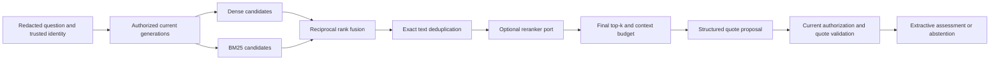

# Retrieval lab: relevance, freshness and trustworthy evidence

Read the [v2 setup guide](production-s2-s3.md) first. This lab explains implemented behavior and experiments still needed before choosing a production configuration. The synthetic corpus and fake providers cannot establish semantic quality, optimal top-k or production capacity.

## Follow one question

For “What does PUB-403 mean in release 2.7?”, trusted identity and the question's service/region/release constrain the current source generations. Source dates, status and document ACLs also apply. Only those chunks can become evidence.



## Plain-English Summary

Search has two independent branches. Fusion combines their ordering, deduplication protects the context budget, and validation controls what the answer may release. Neither a high search score nor valid JSON proves that evidence answers the question.

Pseudocode:

```text
load current authorized chunks, refusing a corpus above the explicit lab cap
embed redacted question with the configured embedding profile
in parallel: scoped dense search and BM25 over authorized text
discard dense IDs not present in the authoritative authorized set
fuse rank positions, then deduplicate identical redacted content hashes
optionally rerank a bounded candidate set; validate reranker output
take final_k, then pack within the context and input bounds
ask provider for structured evidence IDs and exact quotes
recheck current source identity, permissions, dates and quoted substring
persist a supported extractive answer or an explicit insufficient-evidence result
```

Code: `retrieval/contracts.py`, `retrieval/hybrid.py`, `retrieval/indexes.py`, `durable/runtime.py` and `durable/repository.py` under `src/incidentops/`.

## HNSW: what does the index change?

HNSW is an approximate nearest-neighbor graph. Exact search compares eligible vectors directly; HNSW trades additional index memory/build/write work for potentially faster candidate search, with a recall tradeoff. It does not improve the embedding model or authorize a document.

| Parameter | Current starting value | Decision to test |
|---|---|---|
| `m` | 16 | Graph connectivity versus memory and index maintenance |
| `ef_construction` | 64 | Build effort/index quality versus ingestion time |
| `ef_search` | 100 | Query exploration/recall versus latency |

The first two are adapter constructor options; `INCIDENTOPS_HNSW_EF_SEARCH` is configurable at runtime. They are starting values, not measured recommendations. Rebuilding with another index definition requires a deliberate migration: `CREATE INDEX IF NOT EXISTS` does not alter an existing index.

The adapter enables pgvector's `strict_order` iterative scan for its HNSW path. Filtering still matters: tenant/generation predicates restrict returned rows, but do not imply the graph only explores those rows. A restrictive filter can produce fewer candidates or more search work. Never broaden tenant/ACL scope to fill top-k. Compare with exact search at the same filter selectivity and inspect `EXPLAIN (ANALYZE, BUFFERS)` to confirm the actual query plan. Small tables may reasonably use a sequential scan.

Set `INCIDENTOPS_VECTOR_EXACT=true` for the explicit exact reference. Setting `INCIDENTOPS_HNSW=false` alone does not remove an existing index. The local JSON-vector adapter is always exact and is a test/reference adapter, not a production ANN service. See [pgvector's official index/filter guidance](https://github.com/pgvector/pgvector#hnsw).

## Hybrid retrieval and RRF

Dense retrieval can find related wording; BM25 preserves lexical signals such as `PUB-403`, release numbers and configuration keys. Both can fail. This implementation runs them concurrently and uses reciprocal rank fusion:

```text
RRF(chunk) = sum(1 / (rrf_constant + rank_in_branch))
```

Ranks start at 1. Missing a branch contributes zero. With constant 60, a chunk ranked first in one branch and third in the other gets `1/61 + 1/63`. This is a ranking value, not a probability that an answer is true. Raw cosine and BM25 scores have different scales; adding them without calibration is a separate design requiring evaluation.

The BM25 adapter uses `rank-bm25` over authorized text, runs CPU work outside the event loop, and refuses more than 2,000 authorized chunks by default. It rebuilds its scorer for each search. This bounded implementation teaches fusion and policy; a large deployment needs an indexed lexical adapter with the same authorization contract. SQL full-text ranking should not be labelled BM25 automatically.

## There are several different k values

| Setting | Default | Role / tradeoff |
|---|---|---|
| `INCIDENTOPS_DENSE_K` | 40 | Dense candidate recall versus vector query/hydration work |
| `INCIDENTOPS_LEXICAL_K` | 40 | Lexical candidate recall versus fusion work |
| `INCIDENTOPS_RERANK_K` | 20 | Post-dedup candidate budget; limits optional expensive scoring |
| `INCIDENTOPS_FINAL_K` | 5 | Context coverage versus noise and tokens |
| `INCIDENTOPS_RRF_CONSTANT` | 60 | Influence of high versus lower ranks |

`final_k <= rerank_k` is enforced. Context packing can reduce the actual number below final_k. A model cannot cite evidence that a too-small candidate budget excluded. Increasing final_k can dilute context, add contradictions and increase cost.

The reranker is an **implemented injection port with validation**, but the shipped runtime has no semantic reranker configured and reports `reranker="disabled"`. The pre-rerank budget is therefore a fused-candidate cap today. Do not describe those runs as cross-encoder or LLM reranking experiments. A remote reranker also needs timeout, cost, privacy and overload policy.

## Duplicates: three separate decisions

1. **Retrieval duplication:** identical redacted chunk hashes collapse to one evidence representative. Authorized duplicate IDs remain in diagnostic provenance, rechecked when polling a stored answer. This avoids spending several context slots on identical text.
2. **Embedding computation reuse:** the persistent cache uses tenant, embedding identity and redacted content hash. An updated generation can reuse unchanged vectors without reusing an old permission decision. Different tenants do not share cache entries. Splitter/profile changes remain explicit.
3. **Near duplicates:** paraphrases and partly overlapping chunks are not identical hashes. Similarity thresholds, overlap-aware selection or MMR are later experiments; they can remove complementary facts and need evaluation. The current implementation does not claim semantic duplicate detection.

Content hashes do not make sources interchangeable. A current and a superseded runbook can share text while having different authority. Apply scope/freshness first and retain provenance.

## Progressive updates and deletion

Each document has a relational active-generation pointer and revision. An ingestion job pins the redacted artifact/version, expected revision and complete splitter/embedding/batch profile. Workers checkpoint ordered batches, idempotently upsert vectors and atomically compare-and-swap the document pointer only after completion. Updating Acme's runbook does not replace Bravo's corpus or another Acme document.

Reusing a source version with changed redacted text is rejected. Metadata/ACL changes may publish another generation with unchanged content; current-head permission checks prevent a caller granting themselves write access in the incoming document. Concurrent writers can stage work, but only the expected revision wins promotion. The other job fails with a conflict and needs a deliberate new request based on the current head.

Pinecone uses tenant namespaces plus generation/embedding filters; the relational store remains the authority. Acknowledged writes may not be immediately searchable. The current contract prioritizes authorization and complete ingestion checkpoints; it does not guarantee immediate dense visibility after Pinecone promotion. A production visibility barrier/readiness policy and freshness measurements are further work. Newer SDKs document [LSN response metadata for freshness checks](https://sdk.pinecone.io/python/reference/models.html); this project's locked 9.x adapter does not implement that barrier.

Deletion retires the active pointer, so current reads and stored-answer validation stop releasing that source. It is logical deletion. Physical vector/object/cache/backup purge, retention and orphan reconciliation need a separate workflow. Old vectors consuming index space can also affect ANN efficiency until reclaimed.

## Hallucination and abstention

The generator proposes `evidence_id` and `quote`; it cannot write an unrestricted final narrative. Code verifies exact quoted substrings, source hashes and current authorization before releasing claims. Missing retrieval, invalid IDs/quotes, unsupported output or insufficient evidence produce explicit abstention/reason codes. Structured validation alone proves shape, not support.

An exact quote can still be irrelevant, misleading out of context, outdated in reality or contradicted. This mechanism proves textual provenance and controls release; it does not establish causality or complete semantic correctness. Static runbooks cannot reveal today's actual migration status. A later investigator must combine timestamped observations with hypotheses and gaps.

The fake generator recognizes fixture intents. Its tests are plumbing evidence. Real quality evaluation needs independently labelled required evidence, answerability and claim support, plus a held-out set. An LLM judge needs calibration against human labels and cannot replace deterministic tenant/action policy tests.

## Reproducible experiments

Start with the persistent local setup and fake provider for a free mechanics exercise:

```bash
uv run incidentops-workflow migrate
uv run incidentops-workflow seed-local
uv run incidentops-workflow evaluate --output results/v2-k5.json
INCIDENTOPS_FINAL_K=2 uv run incidentops-workflow evaluate --output results/v2-k2.json
INCIDENTOPS_DENSE_K=10 INCIDENTOPS_LEXICAL_K=10 \
  uv run incidentops-workflow evaluate --output results/v2-candidates10.json
uv run incidentops-workflow evaluate --dataset data/eval/holdout.jsonl --output results/v2-holdout.json
```

Reports record dataset digest, candidate settings, backend, embedding identity, reranker status, answerability, required-document coverage and measured execution timings. They currently do not capture a complete corpus snapshot digest or queue-wait distribution. Freeze the corpus manually for comparisons; do not treat execution-only latency as queue latency. Billed tokens and dollar cost remain null.

For a real pgvector experiment, keep corpus/model/query set fixed and compare exact versus HNSW at several ef_search values. Measure dense Recall@k against exact scoped results separately from required-evidence recall, p50/p95/p99, memory, build/update time and filter selectivity. The tiny fake corpus cannot expose a meaningful ANN speed/recall curve. For Pinecone, preserve embedding/distance/filter contracts and measure visibility delay too. No paid provider/index is provisioned by these commands.

Failure exercises:

```bash
uv run pytest -q tests/test_hybrid_retrieval.py tests/test_vector_adapters.py
uv run pytest -q tests/durable/test_repository.py tests/durable/test_workflow.py
```

Inspect unauthorized dense IDs, negative BM25 scores, duplicate provenance revocation, source hash tampering, stale revision conflicts, failed upserts after batch checkpoint and old embedding-profile rejection. Then shrink final_k and explain which required evidence disappeared. Keep the generator fixed while tuning retrieval; change embeddings and generation separately.

## Staff-level interview questions and model answers

**Why both candidate k and final k?** Candidate recall and generator context are different budgets. Retrieve broadly enough for complementary evidence, then select a small context. Optimize required evidence coverage and abstention at a fixed latency/token budget; no universal k works for every corpus.

**Does HNSW solve a poor answer?** It approximates vector neighbors. It can accelerate search while missing a required vector. Compare to exact filtered retrieval first; diagnose chunking, embeddings, fusion and generation separately.

**Why keep PostgreSQL when vectors are in Pinecone?** Jobs, revisions and authorization need an authoritative transaction boundary. Remote IDs are candidates, not permission grants. Hydration/rechecks cost IO but prevent stale remote metadata defining access.

**What if ingestion crashes after a paid embedding call?** Persisted batches avoid repeating completed work and deterministic vector IDs make replay safe. A crash before saving the response can repeat billing. Exactly-once publication and exactly-once provider charges are distinct promises.

**Are citations hallucination detection?** They establish a traceable source if validated. Relevance, entailment, contradictions and causal claims need separate evaluation. Present deterministic guarantees, measured semantic error rates and remaining gaps separately.

**Why not claim production scale now?** Local tests show selected invariants. Capacity, HA and economics require real concurrency/failure workloads, distributed quotas, operating procedures and restore drills. The project makes those experiments concrete and falsifiable.
