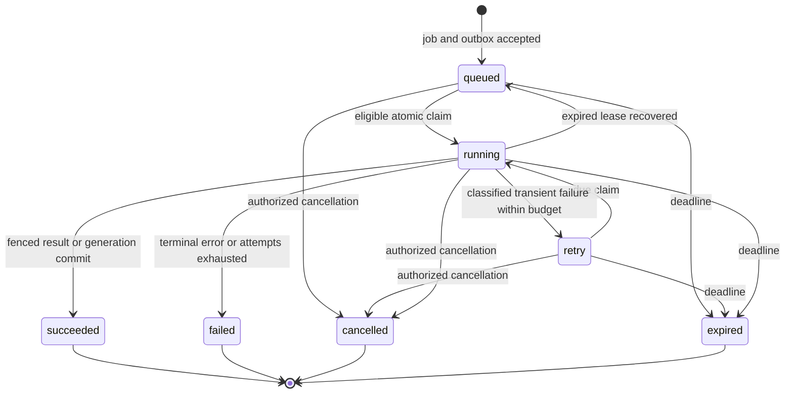

# Low-level design: implemented v2 contracts

Read the [architecture and flow diagrams](architecture.md) first. This document describes current code, not the full [production target](production-design.md). V1's synchronous graph and global snapshot store are retained only through its [legacy path](guides/legacy-v1.md).

## Code reading map

All module paths below are under `src/incidentops/`.

| Module | Owns |
|---|---|
| `models.py`, `security.py` | Typed source/evidence/output contracts, trusted principals, redaction and token authentication |
| `durable/config.py` | Validated backend, retrieval, job and request settings |
| `durable/api.py`, `durable/http_limits.py` | Async HTTP routes, lifecycle, pre-parse body limit and authorized views |
| `durable/runtime.py` | Composition/lifecycle plus ingestion, retrieval, answer and worker use cases |
| `durable/repository.py` | Scoped async SQL transactions, leases, generation publication and event replay |
| `durable/schema.py`, `durable/schema_v1.py` | Current table exports and frozen migration-v1 schema |
| `object_storage.py` | Async immutable artifact contract; filesystem and S3 implementations |
| `chunking.py` | Redacted LangChain Document conversion, recursive splitting, offsets/profile/hash validation |
| `retrieval/contracts.py` | Async vector-index and optional reranker protocols |
| `retrieval/indexes.py`, `durable/local_index.py` | pgvector/Pinecone and persistent local exact adapters; ephemeral memory adapter for tests |
| `retrieval/hybrid.py` | Authorized BM25, parallel branch search, RRF, dedup and candidate budgets |
| `providers.py` | Fake/live embedding and structured quote-selection adapters; native async methods |
| `durable/errors.py`, `durable/broker.py` | Retry classification, confirmed outbox dispatch and Celery task/resource ownership |
| `durable/cli.py`, `durable/evaluation.py` | Migrations, demo, operator commands and persisted-job experiments |
| `tracing.py` | Allowlisted application-owned LangSmith export |

`services/`, `ports.py`, `store.py`, `factory.py`, `pipeline.py` and top-level API/CLI/evaluation are still used by v1. `tests/__init__.py` and `tests/durable/__init__.py` support shared test imports. Schema re-exports and package initializers are not redundant copies of business logic.

## Models and abstractions

A **protocol** describes an operation an adapter must provide. A **generation** is a staged document index whose visibility is controlled by a relational head pointer. A **fence** is a monotonically increasing ownership token; an old worker cannot commit with an old token after takeover. An **outbox** records notification intent in the same transaction as accepted work.

| Type | Role / invariant |
|---|---|
| `Principal` | Frozen trusted tenant/principal/groups, created by server code |
| `Question` | Validated question plus service/region/release; extra JSON rejected |
| `SourceDocument` | Versioned synthetic source and ACL/applicability metadata |
| `Chunk` | Inherits source text/metadata; adds stable chunk ID, hashes, offsets and splitter profile |
| `Evidence` | Authorized chunk plus ranking score; RRF score is not confidence |
| `Draft` / `ProposedClaim` | Untrusted provider answerability, evidence ID and proposed exact quote |
| `Claim` / `Citation` / `Assessment` | Code-validated released excerpts, provenance and explicit status/reason |
| `ObjectRef` | Immutable key, exact version, byte size and SHA-256; opaque versions are preserved exactly |
| `VectorHit` | Candidate chunk ID/score only; remote metadata cannot supply authoritative text |

`ObjectStore` exposes async `put/get/aclose`. `AsyncVectorIndex` exposes async `upsert/search/delete_generation/aclose`. `AsyncReranker` takes a bounded authorized candidate set; its returned IDs/text/scores are validated. The runtime does not configure a semantic reranker yet. LangChain embeddings use `aembed_documents/aembed_query`; the generator uses `agenerate`.

## Relational schema

Alembic migration 0001 uses frozen `schema_v1.py`. Later schema changes need new revisions; importing mutable application metadata into an old migration would change its historical behavior.

| Table | Identity / important contents | Correctness role |
|---|---|---|
| `io_jobs` | UUID; tenant/principal/key unique; canonical request hash, safe payload, status/attempt/fence/lease/deadline/run_after, result/error/event sequence | Accepted intent and execution ownership |
| `io_outbox` | Event UUID, job ID/kind, creation/publication time | Atomic acceptance and eventual notification |
| `io_document_heads` | Tenant/document primary key; active generation, revision, version, deleted flag, current group | Authoritative visibility and optimistic concurrency |
| `io_source_versions` | Tenant/document/version primary key; redacted document hash | Reject edited content under a reused source version |
| `io_generations` | Generation/job UUID; tenant/document/version, expected revision, embedding ID, metadata/hash/status | Immutable staged manifest |
| `io_chunks` | Generation/chunk primary key; tenant/scope/date/status columns, redacted payload and vector checkpoint | Staged and active evidence |
| `io_embedding_batches` | Generation/ordinal primary key; ordered chunk IDs and checksum | Restartable completed batches |
| `io_embedding_cache` | Tenant/embedding ID/content hash primary key; vector | Reuse computation without cross-tenant sharing |
| `io_run_events` | Job/monotonic sequence primary key; allowlisted event/payload | Authorized durable SSE replay |
| `io_local_vectors` | Tenant/generation/chunk primary key; JSON vector | Persistent exact reference adapter |

Relations are enforced by repository transactions/queries; this migration does not declare foreign keys for all conceptual references. The vector JSON in checkpoints and the external vector index serve different purposes: recovery versus candidate search. PostgreSQL vector bootstrap separately provisions `io_vector_config` and `io_vectors`; it is currently an explicit `index-init` lab step, not part of Alembic 0001. Pinecone instead uses tenant namespaces and generation/model metadata filters. SQL remains the authority in both cases.

## Job state flow



## Diagram Summary

Accepted work waits until due, claims one owner, then succeeds, retries or terminates. Lease recovery returns work to the queue, while a new claim advances its fence. Terminal jobs do not execute again. A job may succeed with an `insufficient_evidence` assessment: successful execution and an answerable question are separate concepts.

`Repository.submit()` inserts with a unique tenant/principal/idempotency key and compares the canonical intent hash. Same intent returns the existing job; conflicting intent raises 409. Only a newly inserted job creates its initial outbox/event. Ingestion's request identity excludes a server-captured head revision when the caller omitted it, so an identical retry after completion still returns the same job.

`claim()` uses one conditional UPDATE/RETURNING for due queued/retry or expired-running work. `_owned()` conditionally updates the job row to lock it and verifies tenant, fence, running status, lease and deadline before writes. Heartbeats extend ownership; the runtime supervises both work and heartbeat under the absolute deadline. Cancellation or lease loss prevents final publication; cancelling a client await cannot undo an already started remote request or charge.

Dispatcher publication precedes marking the outbox confirmed. Crashes/two dispatchers can publish duplicates. The reaper expires overdue work, recovers expired owners, marks exhausted attempts and redrives accepted work lost before claim. It records safe monotonic events in those transactions. Leases currently use application wall-clock time; production needs database time or an explicit skew policy.

## Ingestion and progressive updates

```text
submission:
  authenticate; validate tenant and incoming document group
  redact text/metadata; store immutable source artifact
  pin source reference, expected revision, splitter/batch/embedding profile
  transaction: create idempotent job + outbox + queued event
worker:
  claim lease/fence; load verified artifact; require pinned profile unchanged
  split via LangChain; validate exact redacted offsets and bounded count
  transaction: check current write ACL, immutable version hash; begin staging
  for each batch:
    reuse complete checkpoint, otherwise load tenant/model/content cache
    embed only missing text; atomically save chunks/vectors/checksum/cache/event
    idempotently upsert that batch into the selected vector backend
  transaction:
    verify fence, current write ACL and complete chunk count
    compare-and-swap this tenant/document head at expected revision
    advance revision; mark generation active and job succeeded; append event
```

Defaults: 350 characters, target overlap 40, batch size 32, maximum 2,000 chunks. Chunk IDs include source tenant/document/version, splitter profile, position and content identity. Hashes/offsets address redacted text. `RecursiveCharacterTextSplitter` owns splitting mechanics; application code validates provenance rather than reimplementing the algorithm.

A stale revision cannot overwrite another publisher. A forged incoming ACL cannot bypass the current head's write access. Reusing unchanged text may reuse a vector, but every new generation has independently authorized metadata. A deletion job retires the active head at an expected revision and succeeds transactionally; it does not physically purge artifacts, old vectors, caches or backups.

Uploads, relational transactions and remote vector writes do not share a transaction. Orphan/stale generation collection and Pinecone freshness barriers are pending. A completed checkpoint avoids repeated recorded embeddings; a crash before recording a paid response may repeat billing.

## Retrieval and answer validation

`authorized_records()` joins chunks to each document's active nondeleted head and checks trusted tenant/groups, status, effective dates, question service/region/release and current embedding ID. It fetches at most cap + 1 and rejects an oversized authorized corpus instead of silently truncating it. `effective_to` is exclusive; applicability uses the current UTC date. There is no historical-time API.

The query embedding uses the same configured embedding space. Dense search and authorized BM25 run concurrently. Unknown/unauthorized dense IDs are dropped. RRF sums `1 / (constant + rank)` with rank starting at 1, then identical content hashes collapse while preserving authorized duplicate provenance. Defaults are dense 40, lexical 40, fused/rerank budget 20, final 5 and RRF constant 60. They are starting experiment settings, not optimum values.

Context packing can reduce the final evidence set further. The generator proposes IDs and exact quotes from that set. Code requires current source equality/authorization, exact quoted substrings and no introduced redactable content, then constructs citation URLs itself. One bad proposed claim discards all claims. A final source check covers retrieved metadata as well. Polling checks stored citations again and filters duplicate provenance after later revocation/update.

| Assessment reason | Meaning |
|---|---|
| `verified_quotes` | Supported extractive excerpts released |
| `no_evidence` | No eligible/context-fitting evidence; no chat call |
| `not_answerable` | Provider did not select usable support |
| `invalid_grounding` | Quote, identity or current access validation failed |

Provider/schema/infrastructure exceptions in v2 become safe failed/retry **job** states, rather than v1's `provider_error`/`invalid_output` response path. Exact quotes establish provenance, not relevance, completeness, source truth or causality. Semantic support evaluation and calibrated judges remain later work.

## Budgets, errors and async lifecycle

Defaults include a 512,000-byte pre-parse request body cap, 300-second accepted-job deadline, 60-second lease, three attempts, 20-second direct retrieval timeout and per-process HTTP/provider limits. The embedding/context/input bounds and 700-token live output cap constrain individual calls. Input/context estimates use conservative UTF-8 byte bounds, not measured billing tokens. There is no aggregate dollar/token reservation ledger yet.

`durable/errors.py` classifies known HTTP/OpenAI/Pinecone 408/429/5xx, S3 error codes and transient database SQLSTATEs. Domain/revision conflicts, authorization and schema errors are terminal; unknown errors are terminal too. Jobs use finite exponential jitter. OpenAI SDK retries are disabled for v2; boto3 retains finite SDK retries. Retry-After propagation/circuit breakers remain future work. Safe error codes are persisted, not raw exception bodies.

HTTP/model/vector/SQL operations use async clients. CPU splitting/BM25 and bounded synchronous SDK operations run in threads. Celery prefork slots execute one task each with a fresh runtime/event loop; async waits do not multiply those slots. `AsyncExitStack` closes partial construction failures, and successful ownership transfers to `Runtime.aclose()`. A cancelled threaded IO operation keeps its bulkhead permit until actual completion; shutdown drains it.

## HTTP contract and streaming

| Route | Result |
|---|---|
| `POST /v2/ingestion-jobs`, `/v2/answer-jobs`, `/v2/deletion-jobs` | Idempotency-Key required; 202 and Location |
| `GET /v2/jobs/{id}` | Tenant/principal-scoped status and currently releasable result |
| `POST /v2/jobs/{id}/cancel` | Persist cancellation if still eligible |
| `GET /v2/jobs/{id}/events?after=N` | Durable SSE progress after cursor N |
| `POST /v2/retrieve` | Bounded evidence search without chat generation |
| `GET /v2/sources/{chunk_id}` | Current authorized source; absent/hidden/stale returns 404 |
| `GET /healthz` | Process liveness; not a DB/broker readiness check |

Missing/invalid credentials return 401; out-of-scope operations 403, conflicting intent/revision 409, oversized bodies 413 and invalid payloads 422. SQLAlchemy persistence failures have a generic 503 handler; direct retrieval timeout returns 504. This is not a universal dependency-error gateway.

SSE pages 100 events at a time, checks terminal event sequence and closes after a bounded connection interval (30 seconds). Reconnect using `after` and the last observed sequence. It does not emit generated tokens or raw source/model payloads. Jobs and events remain database-backed across API restarts.

## Tracing and sensitive data

Redaction precedes source persistence, embedding/model requests and diagnostics. The synthetic regex redactor covers selected email, IPv4, bearer and secret patterns; it is not comprehensive PII protection. Opaque source object VersionIds are preserved byte-for-byte after source redaction.

Automatic raw nested tracing is disabled. Optional `TraceSink` exports status/reason, provider mode, counts, prompt version, context bound and timing under an opaque run UUID. No raw question, source text, quote, tenant, token or exception payload is exported. The v2 summary records a background-answer stage; it is not a complete distributed trace. Real LangSmith delivery remains opt-in.

## Evaluation and retained files

V2 evaluation executes persisted jobs as a trusted local operator command. Reports include dataset digest, retrieval configuration, embedding identity, backend/HNSW flags, reranker status, answerability, required-document coverage, operational failures and execution timings. The current report does not capture a complete corpus snapshot or queue wait; tokens/cost are null. Fake results are plumbing checks and the visible holdout is a split-layout exercise.

[Verification](verification-v2.md) separates local tests, SDK stubs and unrun service tests. Historical plans/ADRs/results explain earlier behavior and remain labelled as historical. Generated build/cache directories are disposable and ignored; `.local/`, `.env`, `.venv`, results and IDE settings are local working state and are not cleanup targets.
