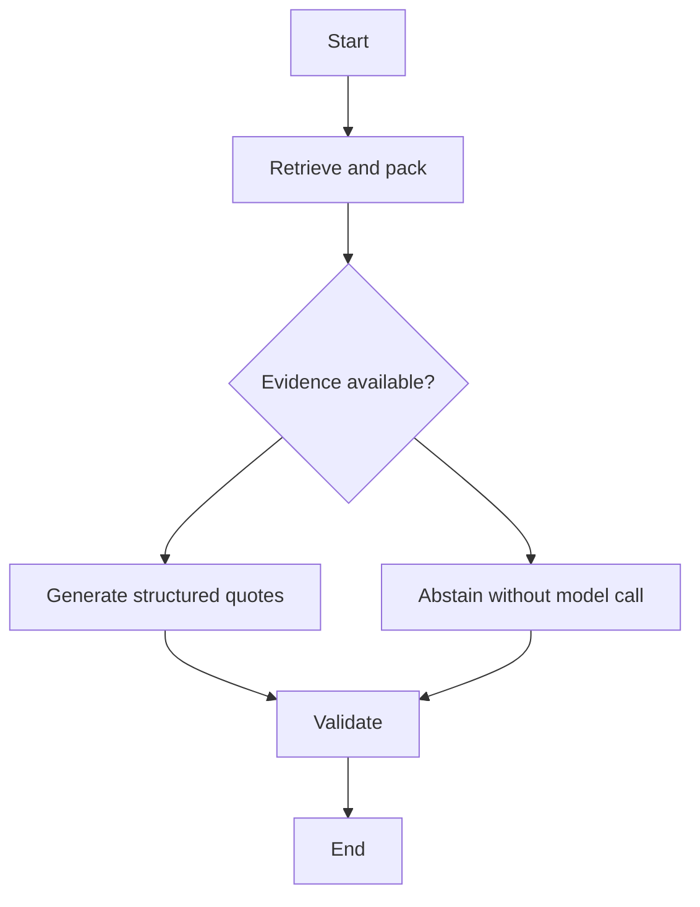

# Low-level design

## Code reading map

Start with `models.py`, then `security.py`, `ingestion.py`, `store.py`, `providers.py`, `pipeline.py`, `api.py`, `tracing.py`, and `evaluation.py`. `factory.py` constructs dependencies; `cli.py` exposes commands. All paths refer to `src/incidentops/`.

An **embedding** is a numerical representation used for similarity search. A **chunk** is the unit retrieved into a model's context. **Grounding** means connecting released claims to evidence; this first implementation checks exact textual support. **Abstention** means returning insufficient evidence instead of inventing an answer.

## Models and contracts

| Type | Important fields | Invariant |
|---|---|---|
| `Principal` | tenant ID, principal ID, access groups | Frozen dataclass created by trusted code |
| `Question` | question, service, region, release | Extra JSON fields rejected; nonblank question, at most 2,000 characters |
| `SourceDocument` | document ID/version, tenant, service/release/region, group, effective dates, status, text | Synthetic corpus input; no raw document content persisted |
| `Chunk` | source metadata, stable ID, text/document hashes, offsets | Hashes and offsets address the redacted source representation |
| `Evidence` | chunk, cosine score | Only scoped rows can enter the candidate set |
| `Draft` | answerable, at most 5 proposed quotes | Untrusted model output, never a final answer |
| `Assessment` | status, reason, mode, verified quotes, citations, metrics | No unrestricted generated narrative |

`Embeddings` is the LangChain interface with `embed_documents()` and `embed_query()`. `Generator` is a small protocol with `generate(question, evidence) -> Draft`. Fake and OpenAI implementations satisfy these same contracts. A later retriever can add hybrid ranking without granting new permissions to the model.

The fake embedding is a 256-dimensional normalized hashed word-count vector. It is deterministic but has collisions and no trained semantic knowledge. The fake generator is a scripted quote selector for a few fixture intents. Neither is a small language model.

## Ingestion pseudocode

```text
parse every fixture as a typed SourceDocument
reject duplicate (tenant, document, version) entries
redact source text and title
split at paragraphs; split oversized paragraphs at whitespace
pack adjacent paragraphs within the conservative token bound
compute redacted document hash, chunk hash and stable chunk ID
embed every chunk outside the write transaction
begin transaction
  reject a reused source version whose document hash changed
  replace the entire indexed snapshot
commit
```

Paragraph packing avoids the observed failure where a heading without its supporting paragraph consumed a top-k slot. It is a modest baseline, not the structural/table/code-aware chunker planned for increment 2. Long tables can still lose headers across chunks. There is no overlap or parent expansion yet.

`ingest` is a trusted batch CLI, not an API upload endpoint. It re-embeds the full small corpus on each call. Failed embeddings or a version conflict leave the prior corpus intact. The PG adapter serializes ingestion writers with a table lock. There is no multi-worker scheduler.

## Storage

`index_config` records the embedding identity and dimension; opening a database with a different embedding space fails. `document_versions` records immutable redacted-text hashes even after a source leaves the current corpus. `chunks` stores explicit scope columns, a redacted JSON payload and an embedding. PostgreSQL uses `vector(dimensions)`; SQLite stores JSON vectors and ranks the already filtered subset in Python.

The conceptual query is:

```sql
SELECT payload, 1 - (embedding <=> :query_vector) AS cosine_similarity
FROM chunks
WHERE tenant_id = :trusted_tenant
  AND access_group IN (:trusted_groups)
  AND status = 'active'
  AND valid_from <= :date
  AND (valid_to IS NULL OR valid_to > :date)
  AND service = :service AND region = :region AND release = :release
ORDER BY embedding <=> :query_vector, chunk_id
LIMIT :top_k;
```

Values are bound parameters. Group placeholder count is generated by trusted code; raw values are never concatenated into SQL. `effective_to` is exclusive. Scope matching is exact; there are no wildcards or shared/public collections. PostgreSQL exact search naturally filters the permitted set before selecting the closest rows; this statement is not an ANN recall guarantee.

Source lookup uses the same tenant, group, active-status and date checks. It intentionally returns 404 for absent, unauthorized or unavailable versions. Current UTC date determines applicability; the POC does not offer historical time travel through the API.

## Graph and conditional edges



Plain-English summary: retrieval can bypass generation entirely. Otherwise the graph performs exactly one generation stage and validates the result. There are no cycle edges, so a recursion limit of eight is only a final guard.

`RAGState` contains a redacted question, bounded evidence, an untrusted draft, reason and claims. Immutable principal and metadata filters live in trusted closures outside model-editable state. `retrieve` catches dependency failures; `generate` distinguishes schema errors from provider errors; `validate` checks all citations, quotes and fresh authorization. A final recheck also protects metadata-only retrieved references.

This small graph is compiled per request so dependencies and principal scope are isolated. That has overhead; a reusable compiled graph with an explicit trusted runtime context is a sensible later optimization after measurement.

## Grounding validation pseudocode

```text
if no evidence or provider/schema failure: return abstention
if provider says unanswerable or selects no claims: return abstention
for every proposed claim:
  require evidence ID was included in this exact request's context
  re-read source under current principal's authorization
  require source representation still equals the retrieved representation
  require quote is an exact substring of the retrieved redacted text
  require quote contains no newly introduced redactable content
  construct citation in code, not from a model-supplied URL
if any check fails: discard every claim and abstain
recheck all retrieval references before releasing their metadata
```

A fabricated quote with a real citation fails. A real quote with an invented citation also fails. A selective quote that omits a necessary caveat can still pass; that is why context completeness and semantic answer support need separate evaluation. There is no general prompt-injection classifier here, and retrieved text remains untrusted.

## Budgets and failure behavior

`top_k` bounds candidates; `context_tokens` bounds the UTF-8 byte length of evidence JSON, including IDs and formatting. For byte-level tokenizers this is a deliberately conservative token upper bound. It is not a measured tokenizer count, total prompt size or billed token usage. The 2,000-character question, fixed prompt/schema and 700-token output cap bound additional input/output components. The default live request timeout is 20 seconds with at most one SDK retry per call.

Retries can make total wall time exceed one timeout. This increment has no end-to-end deadline, cancellation, dollar budget or aggregate token ledger. Those are later resilience work. No error is silently replaced by a fake answer.

| Reason | Released behavior |
|---|---|
| `verified_quotes` | Answered, with verified excerpts |
| `no_evidence` | No candidates fit the scope/budget; no generation call |
| `not_answerable` | Provider refused or could not select support |
| `invalid_output` | Structured schema validation failed |
| `invalid_grounding` | Quote, citation, access or source changed/failed validation |
| `provider_error` | Generation dependency failed; raw exception withheld |
| `retrieval_error` | Embedding or store dependency failed; raw exception withheld |

## Tracing and sensitive data

Redaction precedes persistence, embeddings and model requests. The synthetic redactor covers email-like strings, bearer tokens, common key/value secrets, `sk-` tokens and IPv4-like strings. It does not cover names, addresses, every credential format or adversarial encoding. Do not feed real confidential material into this POC.

Automatic LangChain/LangGraph tracing is disabled inside ingestion and graph execution, even if `LANGSMITH_TRACING` is inherited. An application-owned `TraceSink` emits only status/reason enums, fake/live mode, counts, prompt version, context bound and timings under an opaque run UUID. No identity or raw source IDs are exported. Export failure logs a generic message and does not alter the assessment. Trace duration metrics describe local stages; they are not provider-token billing records.

For prompt debugging, run a fake local test with a breakpoint in `OpenAIGenerator.generate` or print `render_context()` only using the synthetic corpus and tracing disabled. Never change the telemetry boundary to serialize arbitrary state casually. An approved redacted prompt-inspection mode and retention policy can be designed later.

## Evaluation contract

Each JSONL case identifies tenant, question, metadata scope, answerability, required document IDs, required answer substrings and forbidden text. The scorer checks the actual response and independently reloads cited sources. Runtime failures fail cases even when abstention was expected.

Document recall is intentionally coarse: retrieving any chunk from a required document can count even if the necessary paragraph is missing. Reference substrings test only authored examples; they are not an LLM judge or a general semantic metric. Citation integrity can be vacuously true for an empty answer, so answerability and required-content checks must be read alongside it.

`dev.jsonl` covers publication/access questions; `holdout.jsonl` covers a different architecture family. Both are visible, tiny teaching fixtures and the fake selector was authored alongside them. The holdout file is a split-layout example, not an untouched statistical validation set. Expand and independently review it before quality claims. Reports record prompt/embedding configuration, dataset hash, configured corpus file hash, actual indexed redacted snapshot hash, platform and latency. The file hash alone does not prove the database was reingested; compare the indexed snapshot too. No tokens or costs are invented.
