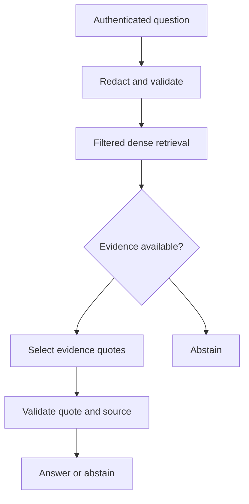

# IncidentOps increment 1 design

Historical design for the original delivery. Its first-increment scope and manual chunking description are superseded by the [active production plan](../production-evolution/2026-11-05-execplan.md) and [current architecture](../../architecture.md). Retained to explain the design's evolution.

The user supplied the IncidentOps design and asked to build it in this checkout. Its first-deliverable boundary is authoritative: implement grounded single-turn RAG only. The remaining six increments are a roadmap, not implemented features.

## Goal and alternatives

Build a reproducible, synthetic cloud-operations knowledge assistant for a senior engineer learning AI system design. Recommended: PostgreSQL/pgvector for the deployable path, SQLite exact vector search and scripted fake providers for offline learning. An in-memory-only tutorial is easier but loses persistent source inspection; a full agent platform obscures the initial retrieval and grounding lessons.

## Decisions

- FastAPI authenticates opaque bearer tokens into immutable principal context; clients cannot select tenants in a request body. Query and source lookup apply tenant, access group, version, date, service, region and release constraints before ranking.
- LangChain provides the embedding interface, prompt composition and OpenAI adapter. LangGraph orchestrates retrieval, generation and validation as an acyclic graph. No checkpointing, conversation, recovery tools or write actions in this increment.
- Source documents are versioned synthetic JSON. Structural paragraph chunks have deterministic content-addressed IDs, source hashes and offsets. Reingestion is atomic and idempotent; embedding configuration is persisted and checked.
- PostgreSQL uses pgvector cosine distance with SQL prefilters and exact search. SQLite is an explicitly labelled development adapter with equivalent policy filters and Python cosine ranking. No ANN, hybrid retrieval or reranking claim.
- The initial answer contract is deliberately extractive: a model selects verbatim quotes and evidence IDs. Code verifies each quote against retrieved, authorized evidence; citation existence alone is insufficient. No free-form paraphrase is released. This checks textual support, not source truth, completeness, relevance or causal correctness.
- No evidence, refusal, malformed output, unknown citations or provider outage yields an explicit abstention. Bounded context and finite provider timeouts/retries constrain resource use. No silent substitution of fake results for a failed live provider.
- Redact before embedding, generation, persistence and tracing. Disable automatic nested traces and emit a small, sanitized application-owned trace with status and opaque run ID only. Regex redaction is a limited synthetic-data demonstration.
- Offline evaluation records answerability, citation presence, evidence recall, latency and configuration. Fake runs validate plumbing only; live quality is opt-in and separately labelled.

## High-level flow

Plain-English summary: trusted identity limits retrieval; only validated source quotes reach the response.

## Boundaries and acceptance

Tests must exercise tenant isolation, document ACLs, stale/future versions, idempotent ingestion, source authorization, redaction, malformed output, unanswerability, fabricated quotes, provider failure, context bounds and API validation. Offline CLI and API smoke tests must run without credentials. PostgreSQL integration runs against a real service when available and is explicitly reported if unavailable. Live OpenAI and LangSmith are never claimed verified without credentials. No production-scale or comprehensive security claim.

## Design review

Controller review against the document-review checklist: approved for this bounded increment. Resolved ambiguity: use extractive claims rather than pretending a citation checker is a semantic hallucination detector. PostgreSQL remains the main deployment path; local SQLite is a labelled test adapter. User's supplied implementation brief authorizes execution and the current-folder destination.
