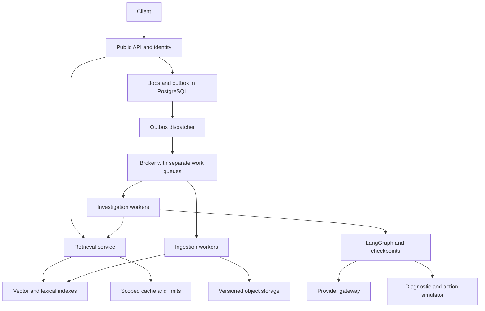

# IncidentOps production evolution: boundaries, guarantees and tradeoffs

**Status:** Researched target design, 2026-11-05. S1 and the S2/S3 durable foundation plus core hybrid retrieval are implemented; read the [v2 guide](guides/production-s2-s3.md) and [verification](verification-v2.md) for the exact boundary. The [living plan](plans/production-evolution/2026-11-05-execplan.md) separates implemented code from unrun service/HA gates. Controls below remain proposed unless included in that implemented boundary.

Use [architecture](architecture.md) for the current flow diagrams and [low-level design](low-level-design.md) for actual tables, interfaces and job states. This document owns technology choices, alternatives and the path from the current implementation to the larger production target.

## Delivery status

| Capability | Current implementation | Still required before a production claim |
|---|---|---|
| Job scheduling | Persisted async ingestion/answer/deletion jobs, outbox, Celery/RabbitMQ entry points, leases/fences/recovery | Actual broker/DB integration, failover, bounded backlog and operational redrive |
| Source updates | Immutable redacted artifacts, checkpointed batches, embedding reuse, per-document CAS promotion and logical deletion | Real S3/IAM checks, retention, orphan GC and physical erasure workflow |
| Retrieval | Local exact, pgvector/Pinecone adapters, HNSW/exact controls, BM25/RRF, dedup, candidate/final k | Remote benchmarks, indexed lexical engine, semantic reranker and Pinecone visibility barrier |
| Deployment boundaries | API, ingestion/answer pools and retrieval-only entry point | Remote retrieval routing/delegated identity, pooling and capacity/failure experiments |
| Limits and privacy | Request/context/batch bounds, deadlines, finite classified retries, process bulkheads, redaction and safe summaries | Distributed Redis quotas/fairness, cost reservations, circuit breakers and production identity/RLS |
| Agent state | Persisted job/batch state and progress SSE; v1 contains a small acyclic LangGraph | Persistent LangGraph investigations, thread/resume policy, memory, tools, approvals and simulator actions |
| Evaluation | Synthetic fixtures, deterministic failure tests and opt-in integrations | Independent semantic labels/judge calibration, complete experiment snapshots and monitoring/load evidence |

The status describes code availability; it does not turn an SDK stub or SQLite test into a real-service result. Redis is not currently a runtime dependency/service.

## Product and engineering goals

Investigate synthetic NimbusCloud publication incidents using versioned knowledge and timestamped diagnostics. Return grounded findings and explicit uncertainty; later execute exact-plan-approved actions only in a simulator. The engineering goal is to learn what fails across process, network, storage and authorization boundaries and demonstrate those failures experimentally.

The original baseline used custom paragraph code, a concrete snapshot store and per-request graph without durable jobs or object storage. S1/v2 replaced those mechanics on the main path. The remaining gaps include global admission/fairness, graph checkpoints, live diagnostics/actions and HA validation. Packaging services in Docker does not resolve those controls by itself.

Use libraries for standard mechanics and application code for domain policy. A LangChain Document carries text/metadata; Pydantic validates required tenant/version/access fields. A splitter decides boundaries; our adapter attaches stable provenance. A broker delivers messages; our ledger decides whether a job may change authoritative state.

## Architecture alternatives and choice

| Approach | Strength | Cost | Decision |
|---|---|---|---|
| Modular application and dedicated workers | Few network boundaries, easy local debugging | Shared deployments until split | Starting implementation structure |
| Modular code with separate API, ingestion and retrieval deployments | Independent resource pools, scale and release boundaries | Network auth, consistency, tracing and operations | Target lab architecture, introduced incrementally |
| Broad event-stream/microservice platform | Replayable events and many independent consumers | Kafka/Flink/orchestration complexity dominates the learning loop | Use only if continuous CDC/stream requirements emerge |

These are workload decisions. Anthropic's agent guidance supports composable workflows and evaluation-driven complexity; it does not establish that any particular platform is necessary. Its article dates to 2024 and itself notes newer tooling. [Source](https://www.anthropic.com/research/building-effective-agents)

## Target services and data flow

## Diagram Summary

Quick retrieval uses a bounded request path; durable jobs use the database/outbox/broker path. Ingestion and investigation workers have separate pools. All paths carry trusted identity and explicit budgets. This is the **target**: Redis/cache coordination, remote retrieval routing, a general provider gateway, durable LangGraph and simulator are still planned. The [current architecture diagram](architecture.md#component-flow) shows what exists today.

| Boundary | Owns | Must not own |
|---|---|---|
| Public API | OIDC/token resolution, admission, idempotent job submission, polling/SSE | Unbounded embedding/parsing or client-selected tenant authority |
| Ingestion service and workers | Parsing, redaction, library splitting, batch embeddings, staging/promotion | A global destructive rewrite for one tenant's upload |
| Retrieval service | Scoped candidate search, fusion/reranking, evidence packing, bounded cache | Recovery actions or an unrestricted agent loop |
| Investigation worker | Graph state, live observations, hypotheses, approval lifecycle | Replacing policy with instructions from retrieved text |
| Provider gateway module | Provider timeouts, retry classification, quotas, token/cost accounting | A second independent retry tree at every layer |
| Simulator | Diagnostics and atomically deduplicated actions | Real cloud credentials |

V2 already has a retrieval-only deployment entry point and an in-process module used by workers. Adding remote routing requires service authentication and delegated principal validation. Use bounded request/response for short searches and a 202 job API for long investigations; a worker queue is not automatically an improvement to every database query.

## Worker/platform decision

**Recommendation for the portable lab: Celery with RabbitMQ for ingestion and long job dispatch; standalone LangGraph for investigation control flow; PostgreSQL for job/graph state.** This lets us inspect delivery and recovery semantics without implementing a message broker. Broker delivery and graph checkpoints solve different problems.

Current v2 orchestration is ordinary async Python backed by job/batch records. The standalone durable LangGraph stage above remains planned; a job lease is not a graph checkpoint.

| Choice | Good fit | Important limitation / tradeoff |
|---|---|---|
| Celery + RabbitMQ | Python task routing, separate pools, local Compose and container deployment | Late acknowledgement alone does not make effects exactly-once; job state and deduplication are still required |
| LangSmith Agent Server | Easiest managed graph-serving alternative if platform operations is secondary | Platform contract/licensing and tenant/scheduling controls need evaluation; use its graph run queue instead of an extra Celery wrapper around those same graph runs |
| Temporal | Long-lived general business workflows with timers, external events and replay | Additional execution model/operations; use as an alternative to Celery orchestration, not another mandatory layer |
| ECS workers + SQS | AWS-native managed queue/compute | Duplicate delivery, visibility extension and DLQs remain application concerns; priority requires separate queues/scheduling |
| Kafka | Durable event log, CDC and replay for independent consumers | Not inherently a fair job scheduler or an action-idempotency mechanism |
| Flink | Stateful continuous transformations, event time/windows, high-volume streaming ETL | Token streaming over SSE is a different problem; per-request LLM jobs do not justify a stream processor |

Celery documents both acknowledgement caveats and routing long/short jobs to dedicated workers. Agent Server documents PostgreSQL-backed run/checkpoint state and Redis coordination. SQS documents duplicate delivery. Flink describes a stream-processing model. These are product capabilities, not a benchmark comparison. [Celery tasks](https://docs.celeryq.dev/en/stable/userguide/tasks.html), [Celery optimization](https://docs.celeryq.dev/en/stable/userguide/optimizing.html), [Agent Server](https://docs.langchain.com/langsmith/data-plane), [Temporal](https://docs.temporal.io/workflow-execution), [SQS](https://docs.aws.amazon.com/AWSSimpleQueueService/latest/SQSDeveloperGuide/standard-queues.html), [Flink](https://nightlies.apache.org/flink/flink-docs-stable/docs/concepts/overview/)

## PostgreSQL, pgvector, Weaviate or Pinecone?

**Keep PostgreSQL/pgvector initially. It is a valid production option, conditional on the workload and operating model.** The reason is transactional coordination with source metadata and familiarity, not a claim that it will win every vector benchmark.

| Option | Why choose it | Tradeoff to measure |
|---|---|---|
| pgvector | SQL/ACL joins, transactionally managed generation pointer, existing Postgres operation | ANN/filter recall, index memory/build time, write amplification, shared relational/vector resource contention |
| Weaviate | Dedicated vector service with native hybrid BM25F/vector retrieval and tenant-aware collections | Additional service, tenant/index operations, model/config migration and authoritative metadata reconciliation |
| Pinecone | Managed retrieval operations and tenant namespaces | Managed-service cost, network dependence, deletion/freshness contract, reconciling a separate metadata authority |

Pinecone recommends namespace-based multitenancy for its model; Weaviate documents tenant isolation and hybrid search. Neither removes the application's need to authorize a document within a tenant. [Pinecone](https://docs.pinecone.io/guides/data/implement-multitenancy), [Weaviate tenants](https://docs.weaviate.io/weaviate/manage-collections/multi-tenancy), [Weaviate hybrid](https://docs.weaviate.io/weaviate/search/hybrid)

For pgvector, distinguish exact scoped search from ANN. Adding HNSW can change filtered recall: SQL WHERE predicates do not mean the ANN graph traverses only authorized vectors. Test selectivity, iterative scans and partitioning against an exact reference; enforce authorization regardless of candidate count. [pgvector filtering](https://github.com/pgvector/pgvector#filtering)

Use one production adapter initially. Benchmark alternatives through a common contract using the same corpus, embeddings, required evidence units, ACL selectivity and concurrency. Measure p50/p95/p99, recall, freshness, ingestion throughput and total cost. Do not choose from vendor leaderboard numbers or install all three databases to make the diagram look advanced. PostgreSQL full-text search is not BM25; the hybrid lab must explicitly name which lexical scorer it uses.

## Durable ingestion contract

1. Authenticate tenant and document ownership. Server selects the object key and permitted priority; clients cannot mint cross-tenant keys.
2. Store an immutable source object and capture exact object version, checksum and size. Current v2 persists only redacted artifacts, with an atomic filesystem adapter for local mode. A separate raw-source tier is not implemented.
3. In one PostgreSQL transaction create the idempotent job and its outbox event. Reusing a key with a different canonical request hash is a conflict, not a silent success.
4. Dispatcher publishes job ID/schema version only, then marks the outbox entry sent. A crash between publish and marking causes duplicates; consumers must tolerate them.
5. Worker atomically claims a lease and fencing token; reauthorize at execution. Parse/redact/chunk with a versioned profile. Never put file bodies, PII or bearer tokens in broker messages.
6. Persist the redacted chunk manifest and embedding batches in a staging generation. Checkpoint completed batches by deterministic IDs. Retrying a batch may still repeat paid provider work unless provider-side idempotency exists.
7. Verify counts, hashes, model dimension, source version and authorization revision. Atomically compare-and-swap the active generation pointer; stale workers with an old fence cannot publish.
8. Mark the job terminal and acknowledge. A later retention/GC workflow must reconcile abandoned staging generations and unreferenced objects before deletion; current v2 retains them.

Object storage and PostgreSQL do not share a transaction. Upload-then-register can leave orphan objects; register-then-upload can leave incomplete jobs. Explicit states and reconciliation close that gap. S3 Versioning preserves object versions, but is disabled by default and requires lifecycle/retention policy. Persist exact VersionId; an object ETag is not a universal content SHA-256. [S3 versioning](https://docs.aws.amazon.com/AmazonS3/latest/userguide/Versioning.html)

The outbox addresses the DB/message dual-write gap, not exactly-once execution. [AWS transactional outbox](https://docs.aws.amazon.com/prescriptive-guidance/latest/cloud-design-patterns/transactional-outbox.html)

**Do not deploy the v1 `replace_corpus()` behind a tenant API.** It deletes the global snapshot and remains a trusted fixture CLI. V2 now uses separate tenant-scoped generations and never calls that writer.

## State, API and ownership contracts

Current migration-managed state is listed below; the complete field map is in [low-level design](low-level-design.md#relational-schema). Generic design names from the original proposal are not additional deployed tables.

| Record | Key / important columns | Correctness role |
|---|---|---|
| `io_jobs` | tenant/principal/key, intent hash, artifact/profile or question payload, status/attempt/deadline/fence/result | Duplicate/conflicting submissions and execution ownership |
| `io_outbox` | event/job UUID, kind, created/published time | Atomic acceptance plus eventual dispatch |
| `io_source_versions`, `io_generations` | immutable version hash and staged generation metadata | Provenance and incomplete-generation isolation |
| `io_document_heads` | tenant/doc, active generation, revision/version/group/deleted | Atomic visibility and current write authority |
| `io_chunks`, `io_embedding_batches`, `io_embedding_cache` | scoped chunks/vectors, batch checksum/IDs, tenant/model/content cache | Restartable ingestion and bounded computation reuse |
| `io_run_events`, `io_local_vectors` | event sequence/payload and local exact reference vectors | SSE replay and offline search |
| Future `job_attempts`, `budget_reservations` | richer attempt history and atomic spend accounting | Planned; not present in migration 0001 |

Implemented endpoints: `POST /v2/ingestion-jobs`, `/v2/answer-jobs` and `/v2/deletion-jobs` (202 + Location, Idempotency-Key), `GET /v2/jobs/{id}` (tenant/principal-scoped), cancellation, `GET /v2/jobs/{id}/events` (SSE cursor), sources and `POST /v2/retrieve` (bounded search). Stateful investigations are later work. Internal remote retrieval must use service credentials plus validated delegated identity; currently workers call the module in-process. Job status must not leak another tenant's existence.

## Resilience and load policy

| Control | Policy and failure behavior | Demonstration gate |
|---|---|---|
| Deadlines | Absolute end-to-end deadline; each dependency gets remaining time; reject expired queued work | A queued request expires without calling the model |
| Retry | One owning layer, classified transient errors, bounded exponential backoff/full jitter and Retry-After | 400/403/schema errors are not retried; provider failure does not amplify across five layers |
| Rate limits | Shared per-tenant plus provider RPM/TPM; atomic Redis operations through a maintained limiter/adaptor; reserve cost in Postgres | Two API replicas cannot double the tenant allowance |
| Bulkheads | Separate worker queues/processes and connection/concurrency pools for interactive, ingestion and provider work | Batch saturation leaves reserved interactive capacity usable |
| Admission | Bounded queued count/bytes, maximum source/chunk count and request body; 429 tenant quota or 503 capacity with retry hints | A flood is rejected predictably without growing memory indefinitely |
| Small vs big | Classify by parsed bytes/chunks/estimated tokens, not client labels; route large jobs separately | One huge upload does not occupy every worker |
| Priority/fairness | Server-approved classes; reserve capacity, age waiting jobs, weighted tenant admission; priority queue alone cannot prevent starvation | Low-priority progress continues under sustained high-priority load |
| Circuit breaker | Per-provider failure window and bounded half-open probes; integrate with retry/deadline budget | One dependency outage does not consume all pools |
| Cancellation | Persist cancellation, check between phases; graceful drain then lease expiry/fencing | Cancelled runs stop further tool/model calls; already-running remote work may still be billed |
| Cache | Tenant/principal or ACL digest + policy revision + corpus/index generation + model/prompt/retrieval profile | Revoked access cannot reuse an old answer; TTL is a backstop, not revocation correctness |
| Cost | Conservative input/output reservations before a call; settle actual usage on completion | Concurrent jobs cannot overspend by racing the same remaining budget |

Redis is not the source of truth for job completion, action approvals or durable audit events. Distinguish per-process semaphores from distributed limits. Prefer DB connection pools and SDK-native async clients; do not declare a function async while calling blocking IO on the event loop. Do not assume cancelling a thread stops its underlying IO.

AWS explains how retries can worsen overload; Google SRE explains load shedding, criticality and queue behavior. These inform the policies above; numeric settings still need our measurements. [AWS retry guidance](https://aws.amazon.com/builders-library/timeouts-retries-and-backoff-with-jitter/), [Google SRE overload](https://sre.google/sre-book/handling-overload/)

## LangGraph durability and streaming

Compile a reusable graph with trusted runtime context and a PostgreSQL checkpointer; authorize every thread/run/resume operation. A worker claiming a job is separate from loading a graph checkpoint. Serialize updates to a thread or define an explicit conflict policy. Reducers merge stable evidence IDs deterministically; no unbounded append-only history.

Checkpoint payloads need encryption/access/retention and redaction policy. Checkpoints do not deduplicate external mutations. Simulator action keys bind tenant, exact plan hash, resource revision and approval expiry; an unknown action outcome is reconciled with executor state before retry. [LangGraph persistence](https://docs.langchain.com/oss/python/langgraph/persistence), [AWS idempotent APIs](https://aws.amazon.com/builders-library/making-retries-safe-with-idempotent-APIs/)

SSE progress events may stream immediately; release final factual claims only after grounding/authorization checks. SSE is an HTTP delivery mechanism, Kafka is an event log, and Flink is a stream processor. They are not interchangeable definitions of streaming. Persistent event sequence/cursor supports reconnect; Redis notifications can wake consumers but cannot be the only replay store.

## SOLID in concrete code

| Principle | Application | Avoid |
|---|---|---|
| Single responsibility | Splitter adapts Documents; ingestion coordinates batches; retriever obtains evidence; policy validates release | One class loading files, owning transactions and generating answers |
| Open/closed | Swap a chunker/retriever/object-store adapter through a narrow protocol | A new framework solely to add interchangeable classes |
| Liskov substitution | Each index adapter must honor authorized search, provenance and errors; contract tests | Fake/SQLite success treated as proof of remote consistency |
| Interface segregation | Readers do not need ingestion/deletion methods; ingestion CLI does not build a chat client | Giant repository interface shared by every service |
| Dependency inversion | Use cases depend on contracts; factory supplies psycopg/LangChain/provider adapters | Business logic importing a concrete database to choose its own infrastructure |

SOLID alone provides no availability or isolation guarantee. Transactions, authorization checks, load tests and crash tests must prove observable behavior.

## Deployment and capacity model

Local profiles should add infrastructure only when the relevant stage is runnable: core (API/Postgres), jobs (RabbitMQ/workers), cache (Redis), objects (a verified S3-compatible local adapter or opt-in AWS). A local filesystem adapter is not proof of S3 behavior. Do not advertise a Compose profile for a worker that has no job implementation.

Optional AWS target: ECS services/tasks for API, retrieval and workers; RDS PostgreSQL with an available compatible pgvector version, S3 versioned storage, ElastiCache, managed RabbitMQ or a consciously selected SQS adapter. Evaluate EKS only when Kubernetes expertise/requirements justify its operational cost. ECS service scheduling replaces failed tasks; it does not make a job idempotent. [ECS services](https://docs.aws.amazon.com/AmazonECS/latest/developerguide/ecs_services.html)

Capacity experiments must declare tenant mix, source size, request size, provider quotas, model token distribution, concurrency, cache hit rate and ACL selectivity. Illustrative calculation only: 20 requests/s at 0.2 s retrieval needs roughly 4 concurrent retrievals; 5 s generation needs roughly 100 concurrent generations. That does not imply the provider permits 100 calls or enough TPM. Use measured means for Little's Law, burst limits for admission and tail latency for deadlines; never turn this arithmetic into a benchmark result.

No invented production traffic, p99 target, vector count threshold or price. Start with a local workload sweep and publish overload curves, queue age and provider-spend distribution before choosing SLOs. Separate queue waiting from execution time. Avoid tenant IDs as unbounded metric labels; keep authorized per-run diagnostics in controlled logs/traces.

## Implementation sequence and gates

| Step | Shippable outcome | Acceptance gate |
|---|---|---|
| S1 | Library chunking + explicit ingestion/retrieval modules + bounded embedding batches | Unicode offsets, redaction, profile IDs, batch failure preserves snapshot, existing policy tests pass |
| S2 | Migration-managed tenant generations + object/version manifests + job/outbox contract | Parallel tenants cannot overwrite each other; failed staging is never visible |
| S3 | Actual broker and workers with restartable stages | Kill worker after write/before ack; duplicate delivery and stale lease cannot double-publish |
| S4 | Separately deployable async retrieval + budgets/admission/bulkheads | Multi-replica tenant quota, large/small isolation, timeout, cancellation and queue saturation tests |
| S5 | Hybrid/reranking/cache and actual usage accounting | Evidence coverage, revocation, cache stampede, price/config-versioned cost reports |
| S6 | Stateful investigations, approvals, simulator and SSE | Graph restart, unauthorized resume, replay-safe action, reconnect without missing events |
| S7 | Load/fault/quality gates and deployment exercise | Dependency kill/recovery, restore drills, held-out regressions and declared operational limits |

For every stage: ADR, diagram/pseudocode, failure exercise, exact commands, actual evidence and interview explanation. The earlier quality roadmap still supplies RAG experiments; it must not delay foundational tenant-safe job/storage work.

## Staff/Principal interview exercise

These questions are authored from the design, not claimed to be a company's interview bank. Public expert material informs the reasoning: Will Larson describes strategy as learning across concrete design decisions; demonstrate that through experiments and migration tradeoffs rather than a technology checklist. [StaffEng strategy](https://staffeng.com/guides/engineering-strategy/)

1. **Accepted job, broker down: where is the work?** In a committed job/outbox transaction; dispatcher retries. Acceptance durability and delivery latency are separate metrics.
2. **Worker succeeds then crashes before ack?** Delivery may repeat. Fenced idempotent promotion handles replay; provider charges may repeat. Acknowledge only after durable terminal state.
3. **Why not make every retriever a queued workflow?** Short RPCs need predictable deadlines; large investigations need durable scheduling. Different service classes justify different paths.
4. **Why not choose Pinecone immediately?** It may simplify index operations, but moves consistency across another boundary. Benchmark filtered evidence recall, isolation, cost and operational burden before migrating.
5. **Does async increase capacity automatically?** It can reduce waiting-thread overhead, but provider TPM, DB pools, CPU parsing and admission still bound throughput.
6. **How does priority avoid starving small tenants?** Server-authorized classes plus reserved pools, per-tenant caps and aging; broker priority alone has no fairness guarantee.
7. **What does a checkpoint guarantee?** Recorded graph progress at its persistence boundary, not exactly-once external side effects or tenant authorization.
8. **What happens when Redis fails?** Cache bypass may be allowed within bounded capacity; global admission/cost controls need an explicit fail-closed or conservative degraded policy. Do not fail open silently.
9. **Which exact invariants have you demonstrated?** Read each milestone's verification record. Distinguish code, local tests, actual network integration and production workload evidence.
